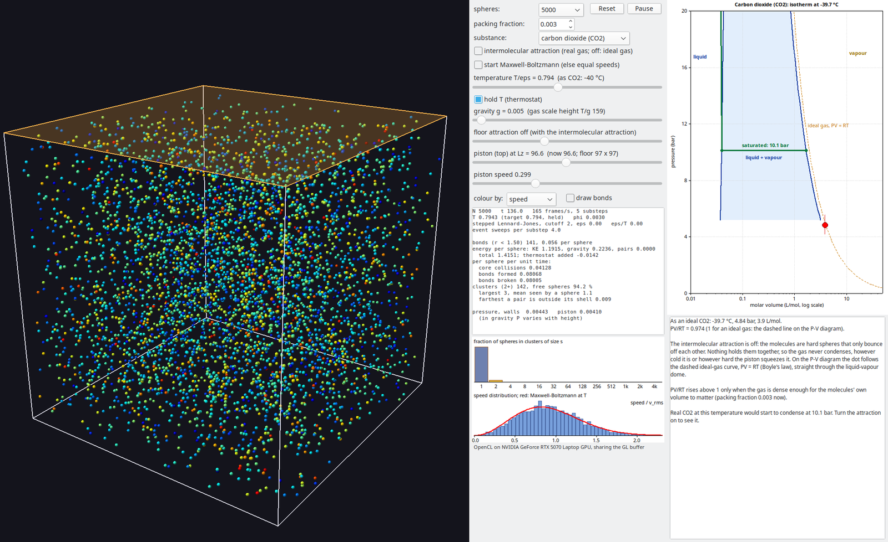

# Isotherms

Ideal and real gases as spheres in a box, beside the P–V isotherm of nitrous
oxide, carbon dioxide or water. A teaching aid for isotherms, condensation and
the pressure of a saturated vapour. It joins HardSpheres (no attraction) and
N2OPhase (attraction, mapped onto N₂O) in one program.


## The two switches

- **Substance:** nitrous oxide, carbon dioxide or water. The simulation is the
  same for all three. Only the mapping onto the substance changes: the
  temperature label, the P–V diagram (its liquid–vapour dome, flat line and
  critical point come from NIST) and the red dot. You can switch while it
  runs.
- **Intermolecular attraction:** on, the spheres attract (stepped
  Lennard-Jones, as in StickySpheres). That makes a real gas, which condenses
  into liquid when compressed below its critical temperature. Off, they are
  hard spheres that only bounce off each other. That is an ideal gas until
  the spheres' own volume starts to matter (PV/RT above 1). On the P–V diagram
  the dot follows the ideal-gas curve straight through the dome, because
  nothing makes it condense. The floor's attraction goes off with it, and the
  spheres are coloured by speed, since "bonds" mean nothing without
  attraction. You can switch while it runs.



Pairs bind and unbind only through energy-conserving collisions: there is no
inelastic capture option, so the gas is always in equilibrium.

## Mapping onto the substance

The well depth ε is the unit of energy, with the attraction on or off, so
switching it off doesn't move the temperature.

- **Temperature:** T = (T/ε) × Tc / 1.035, so the model's critical
  temperature (1.035, measured; see [`../N2O/README.md`](../N2O/README.md))
  lands on the substance's: N₂O 36.4 °C, CO₂ 31.0 °C, water 373.9 °C. The
  default T/ε 0.79 is −37 °C as N₂O, −40 °C as CO₂ and 223 °C as water.
- **Pressure, attraction on:** as in N2OPhase. While liquid and vapour coexist
  it is the substance's vapour pressure (the flat line). Otherwise it is the
  measured pressure scaled by the model's own vapour pressure at that
  temperature, or by the critical pressures above Tc.
- **Pressure, attraction off:** the measured pressure scaled by the critical
  pressures.
- **Volume:** the lever rule between the saturated volumes while liquid is
  present; otherwise the simulation's PV/NkT is kept.

How well each substance fits a spherical model: N₂O and CO₂ fit closely
(both are small linear molecules, and real fluids' Zc is 0.274 for both
against the model's 0.28). Water fits worst: its hydrogen bonds give it Zc
0.229 and a steeper vapour-pressure curve. While liquid is present the dot sits
on water's real curve whatever the model does, but an unsaturated vapour's
pressure is the model's.

## Substance data

`n2odata.inc`, `co2data.inc` and `h2odata.inc` are the NIST Chemistry WebBook
saturation tables, triple point to critical point: T, P, and liquid and vapour
densities. They are thinned so that linear interpolation stays within 0.5 % of
the full tables. `usubstance.pas` holds the critical and triple points, a
Clausius–Clapeyron sublimation curve and a straight melting line for each
substance. Water's melting line slopes backwards, because ice melts under
pressure. It also holds the note shown while the vapour is saturated:
- N₂O: cylinder pressure;
- CO₂: cylinder pressure, and dry ice subliming because the triple point is
  above 1 atm;
- water: humidity in the lungs, and boiling.

## Build and run

```
lazbuild --ws=gtk2 Isotherms.lpi
./run-nvidia.sh            # GL on the NVIDIA GPU, sharing the buffer with OpenCL
```

It uses the simulation in `../Sticky` (`ustickysim.pas`, and `sticky.cl`,
found there at run time) and `../clgl.pas`. Options:
- from StickySpheres: `--n`, `--phi`, `--g`, `--floor`, `--temp`, `--nohold`,
  `--maxwell`, `--snapshot`, `--frames`;
- `--substance=n2o|co2|water`, and `--ideal` (attraction off);
- `--compress=<f>` (after 100 frames move the lid to f times its height) and
  `--speed=<piston speed>`.

Like the others, it won't run OpenCL on an integrated GPU unless given
`--allow-igpu`.

Left out compared with the programs it joins:
- from StickySpheres and N2OPhase: the well-depth slider and the square-well
  potential;
- from HardSpheres: the adiabat on the P–V diagram.

The wall pressure of a dilute gas of a few thousand spheres is noisy (about
±15 % frame to frame at the default density). Use more spheres, or watch the
trail rather than the dot.
