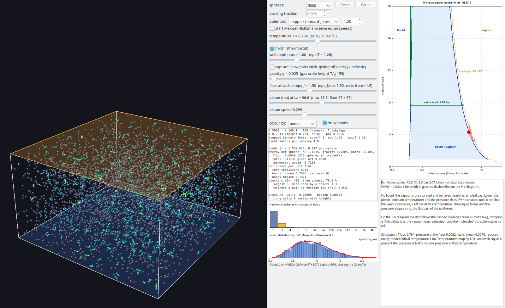
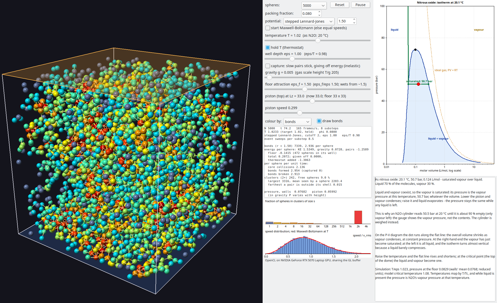

# N2OPhase

A teaching aid for anaesthesia trainees: the liquid–vapour simulation of
[`../Sticky`](../Sticky) beside the pressure–volume diagram of **nitrous
oxide** at the current temperature: the **isotherm**, with the liquid–vapour
dome and the ideal-gas isotherm for comparison, and a red dot for the
simulation's state with a trail of where it has been.

Lower the piston on an unsaturated vapour and the dot follows the ideal-gas
curve (Boyle's law) towards the vapour pressure. Once liquid forms, the
pressure stops rising and the dot runs along the flat part of the isotherm
however far the piston goes. This is the difference between an ideal gas
and a saturated vapour, and the reason a cylinder gauge reads the vapour
pressure, not the contents.



*The default start, part-way through a slow compression: 5,000 spheres as a
dilute vapour at −45.5 °C (as N₂O), still unsaturated. The trail follows the dashed
ideal-gas isotherm.*


*After the piston has compressed it to a twelfth of its height: liquid has
formed on the floor, and the dot is on the flat line at 7.7 bar, N₂O's vapour
pressure at −45.5 °C, having run along it to 61 % liquid. The loop above
the dome is a supersaturated vapour: it ran past the saturation point while droplets nucleated, then dropped onto the line.*



*At 20.1 °C (T/ε 1.023) and a higher packing fraction: liquid and vapour
at 50.7 bar, as in a cylinder. Near the critical point (36.4 °C) the flat
part of the isotherm is short and the liquid and vapour look much alike.*

## Build and run

```
lazbuild --ws=gtk2 N2OPhase.lpi
./run-nvidia.sh            # GL on the NVIDIA GPU, sharing the buffer with OpenCL
```

It uses the simulation in `../Sticky` (`ustickysim.pas`, and `sticky.cl`,
found there at run time) and `../clgl.pas`, so build Sticky's sources as they
are; nothing is copied. Options are those of StickySpheres plus
`--compress=<f>` (after 100 frames move the lid to f times its height),
`--speed=<piston speed>` and `--capture` (off by default here).
`--snapshot` also prints the text under the diagram.

## N₂O data

`un2ophase.pas` holds the saturation data: 57 of the 601 saturation points
of the NIST Chemistry WebBook's reference equation of state for N₂O
(`n2odata.inc`, triple point to critical point), interpolated as ln P linear
in 1/T. It gives 31.3 bar at 0 °C, 45.0 bar at 15 °C and 50.5 bar at 20 °C.
Below the triple point the vapour pressure is the sublimation curve
(Clausius–Clapeyron with the enthalpy of sublimation).

The unit also has a pressure–temperature phase diagram control,
`TN2OPhaseDiagram`. An earlier version showed it above the P–V diagram;
it was taken out because it didn't add much for teaching.

The text under the diagram says what the state is and what that means:
saturated or not, why the pressure does or does not change with the
piston, and what happens above the critical temperature.

## The P–V diagram

`un2opv.pas` draws the isotherm at the current temperature. Molar volume
is across, in L/mol on a log scale, so the liquid (~0.04 L/mol) and the
vapour (litres) both show. Pressure is up, linear in bar, with the range
set from the vapour pressure.

- **The dome:** the saturated liquid and vapour molar volumes from the
  triple point to the critical point (NIST, 44.013 g/mol), meeting at the
  critical point, 0.0974 L/mol and 72.4 bar.
- **The real isotherm at T** (green), below the critical temperature: the
  flat tie line at the vapour pressure between the saturated liquid and
  vapour volumes, and a steep liquid branch above it. The liquid branch is
  schematic: a liquid barely compresses.
- **The ideal-gas isotherm** P = RT/V at T (dashed).
- **The dot's molar volume:**
  - with liquid present, the lever rule between the saturated volumes, by
    the fraction of spheres in droplets, so the dot slides along the flat
    line as vapour condenses;
  - otherwise, the simulation's own compressibility factor Z = PV/NkT
    kept, so an ideal vapour sits on the dashed line and any departure is
    the model's. A dilute vapour shows Z ≈ 0.99, falling to about 0.85
    near saturation (N₂O: about 0.9).

## Mapping the simulation onto N₂O

The spheres are a generic simple fluid (stepped Lennard-Jones), so they
are mapped onto N₂O by **corresponding states**: the same reduced
temperature T/Tc.

- **Temperature:** T(N₂O) = (T/ε) × 309.52 K / 1.08, where 1.08 is the
  model's own critical temperature. The temperature slider shows the
  result in °C.
- **Pressure, liquid present** (3 % of the spheres or more in droplets of
  32 or more): the vapour is saturated, and the dot is put on N₂O's
  vapour-pressure curve at that temperature. Waiting for one big cluster
  instead left the dot well above the curve while many droplets were
  already growing.
- **Pressure, no liquid:** the measured pressure, divided by the model's own
  saturated vapour pressure at that temperature, times N₂O's. So the dot is
  as far below the curve as the vapour is from saturating, and briefly
  above it while a supersaturated vapour waits for droplets to nucleate.
- **Above the critical temperature:** the measured pressure scaled by the
  critical pressures.

**Defaults here differ from StickySpheres:**
- **packing fraction 0.003:** a dilute, unsaturated vapour to start with;
- **T/ε 0.79:** about −46 °C as N₂O;
- **gravity 0.005:** see below;
- **capture off:** with capture on, the inelastic sticking binds far more
  vapour pairs than equilibrium would (38 % of the spheres against about
  16 %), and the vapour's PV/RT came out 0.62 instead of about 0.95;
- **piston speed 0.3:** slow enough for the vapour to keep near
  equilibrium as it is compressed.

**Which pressure.** In gravity a vapour thins with height, and it first
saturates at the floor. So the vapour's pressure is the floor's,
recovered from the mean over all six walls with the isothermal barometric
profile P0 exp(−z g/T). The lid alone would do, but few spheres reach it
and it is too noisy. Gravity defaults to 0.005 here (scale height T/g ≈ 160,
more than the box), against 0.05 in StickySpheres. At 0.05 a dilute vapour
is packed into the bottom few diameters and is already supersaturated
there, unlike N₂O in a cylinder.

**The model's coexistence**, measured from the simulation (scratch programs,
not in the repo):

| T/ε | vapour pressure | liquid density | vapour density |
|---|---|---|---|
| 0.60 | 0.0015 | | 0.0028 |
| 0.65 | 0.0030 | 0.817 | ~0.004 |
| 0.70 | 0.0055 | 0.787 | ~0.006 |
| 0.75 | 0.0097 | 0.756 | ~0.012 |
| 0.80 | 0.0148 | 0.726 | ~0.018 |
| 0.85 | 0.0229 | 0.693 | ~0.029 |
| 0.90 | 0.0335 | 0.656 | ~0.046 |

- **How the vapour pressures were measured:** with the liquid lying on the
  floor under weak gravity (g 0.002 and 0.02), from the lid's pressure
  corrected for the vapour's weight. They agree with the vapour density to
  about 5 % (the vapour is slightly non-ideal).
- **Vapour pressure fit:** ln P = 3.0 − 5.74/T.
- **How the liquid densities were measured:** from a flat liquid slab on the
  wetting floor at g 0.02, over the middle of the floor.
- **Critical point:** fitting (ρl − ρv)^(1/0.325) linear in T gives
  Tc = 1.08 and a critical density of 0.31. That makes Pc ≈ 0.095 and
  Pc/(ρc Tc) ≈ 0.29, close to real fluids (N₂O 0.274).
- **Cross-check:** in the program, the vapour over the liquid at T/ε 0.794
  measures 0.0148 at the floor, against 0.0146 from the fit. The dot would
  sit on the flat line even without being put there.

**Limits.** A one-parameter mapping (T/Tc) can't reproduce every property
of N₂O: its molecules are not spheres, and the model's vapour-pressure
curve is a little steeper in reduced terms (N₂O's acentric factor is 0.16,
a simple fluid's about 0). Pinning the dot to N₂O's own curve whenever
liquid is present hides that. The model's own freezing point has not been
measured: below −90.8 °C the dot follows the sublimation curve and the text
calls the condensate solid, whatever the spheres are doing.

**Also fixed in `../Sticky/sticky.cl` for this:** the floor's attraction
changes each sphere's momentum when it crosses into or out of the floor's
well. Those changes now count in the wall impulse. Without them, a
populated well made the floor's pressure read many times too high (0.17
against a true 0.015). Energy and the dynamics are unchanged.
