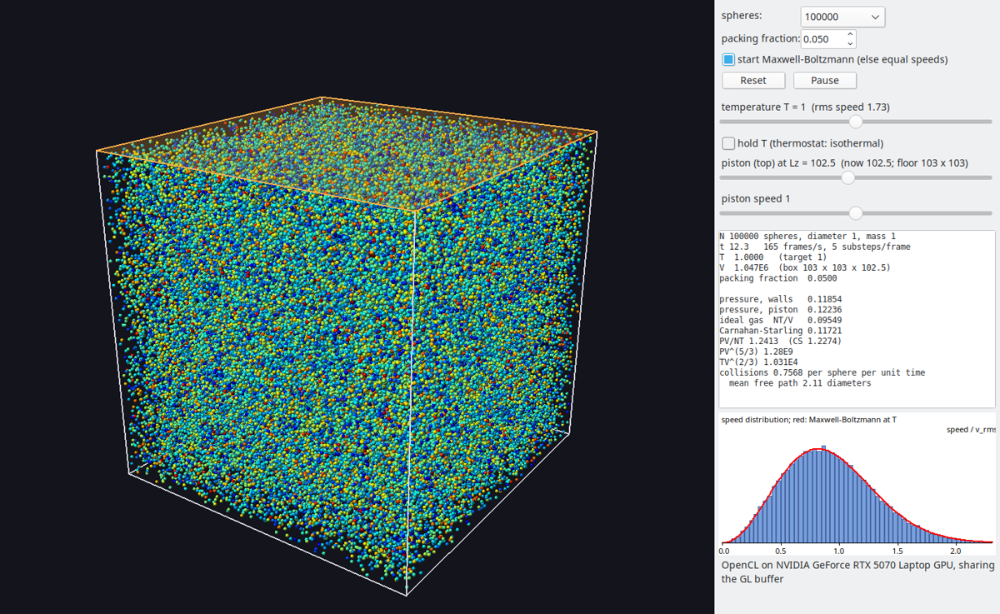
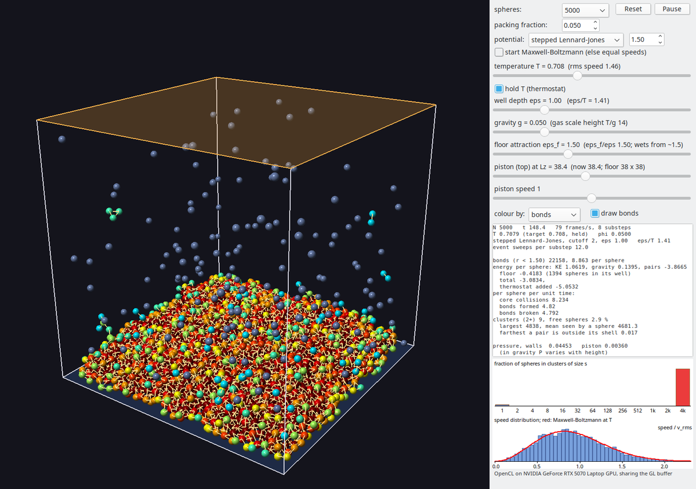
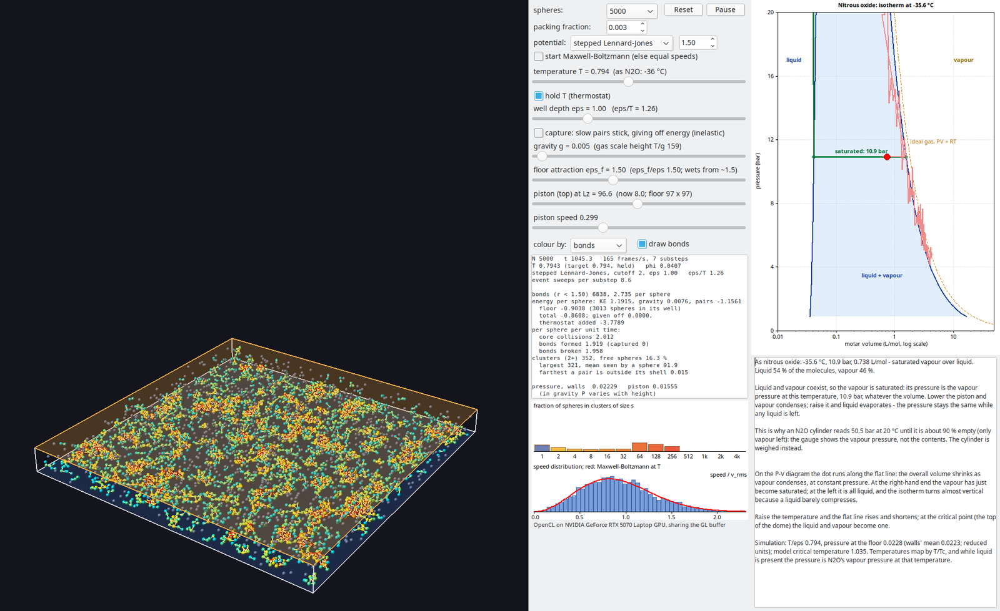
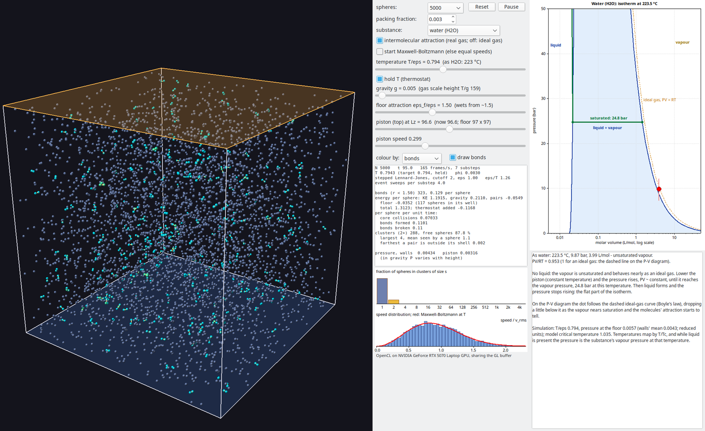
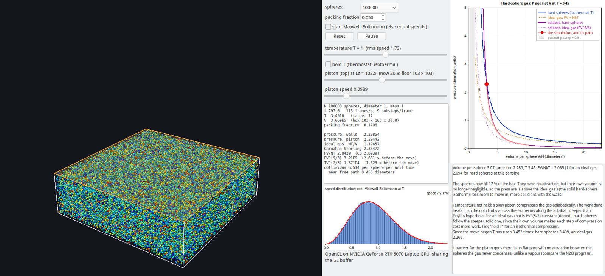

# HardSpheres

An ideal gas, and at higher density a non-ideal one, simulated as hard spheres in a box with a piston. The simulation runs in OpenCL on the GPU, and OpenGL draws the spheres in real time from the same buffer.



*100,000 spheres at packing fraction 0.05, coloured by speed. The orange top face is the piston. On the right are the controls, the readouts (pressure against Carnahan–Starling), and the speed histogram against Maxwell–Boltzmann.*

The sticky version in [`Sticky/`](Sticky/) adds attraction, binding and gravity:



### N2OPhase: nitrous oxide

[`N2O/`](N2O/) (N2OPhase) is a teaching aid built on the sticky spheres. It maps them onto nitrous oxide by corresponding states and puts a red dot for the simulation's state on N₂O's P–V isotherm. Compress a vapour with the piston and the dot follows Boyle's law up to the vapour pressure; once liquid forms the pressure stops rising and the dot runs along the flat line. That is why a cylinder gauge reads the vapour pressure, not the contents.



*5,000 spheres at T/ε 0.794 (−35.6 °C as N₂O), compressed to a twelfth of their height: liquid on the floor, saturated vapour above, and the dot on the flat line at 10.9 bar, N₂O's vapour pressure. The trail shows the compression run along the ideal-gas curve and overshoot slightly as supersaturated vapour before droplets formed.*

The model's critical point was measured with 1,000,000 spheres: [`N2O/n2o_isotherms.png`](N2O/n2o_isotherms.png) shows its isotherms at 0 °C, 20 °C, the critical temperature and 100 °C against N₂O's measured dome. See the [N2O README](N2O/README.md).

### Isotherms: ideal and real gases

[`Isotherms/`](Isotherms/) joins the two in one program. Choose the substance from a dropdown (nitrous oxide, carbon dioxide or water), and switch the intermolecular attraction on for a real gas that condenses, or off for an ideal gas that follows PV = RT straight through the liquid–vapour dome. See the [Isotherms README](Isotherms/README.md).



## Build and run

```
lazbuild --lazarusdir=$HOME/Lazarus --ws=gtk2 HardSpheres.lpi
./run-nvidia.sh            # OpenGL on the NVIDIA GPU: CL-GL buffer sharing
./HardSpheres              # default GL (Intel iGPU): positions copied each frame
fpc -O2 gascheck.lpr && ./gascheck [N]     # headless physics checks
```

`gas.cl` must sit beside the executable; it is compiled at start-up.

On a hybrid-graphics laptop, OpenGL runs on the integrated GPU unless NVIDIA PRIME offload is requested. OpenCL–OpenGL sharing needs both on the same device. `run-nvidia.sh` sets `__NV_PRIME_RENDER_OFFLOAD=1 __GLX_VENDOR_LIBRARY_NAME=nvidia`. Without it the program still runs, copying positions through the host, and says so in the status line.

The program will not run OpenCL on an integrated GPU (one sharing memory with the CPU). On a laptop that GPU drives the display, and a hang there can lock up the desktop past a failed GPU reset. That can happen if the NVIDIA driver isn't loaded, for example after a kernel update without its NVIDIA module. With no other GPU, the program stops with an error. Pass `--allow-igpu` (to `HardSpheres` or `gascheck`) to run on the integrated GPU anyway.

### Speed: discrete against integrated GPU

The hard-sphere simulation (`ugassim.pas`) timed headless on each GPU of a
laptop with an Intel Raptor Lake-S UHD and an NVIDIA RTX 5070 Laptop GPU
(8 GB). Simulation only, no drawing; 5 substeps per frame in every case.

| spheres | packing fraction | RTX 5070 | Intel UHD | 5070 faster by |
|---|---|---|---|---|
| 5,000 | 0.05 | 4,405 frames/s | 667 frames/s | ×6.6 |
| 100,000 | 0.05 | 951 frames/s | 55 frames/s | ×17 |
| 100,000 | 0.30 | 570 frames/s | 38 frames/s | ×15 |
| 1,000,000 | 0.30 | 29 frames/s | 2.5 frames/s | ×12 |

At a few thousand spheres both are far above the screen's refresh rate,
and the time per frame is mostly the fixed cost of launching kernels. From
about 100,000 spheres the integrated GPU falls below a smooth frame rate,
while also drawing the desktop. The integrated GPU ran these without
stalling the display.

To choose the GPU, restrict the OpenCL loader to one driver. Point
`OCL_ICD_VENDORS` at an empty or missing folder, or the drivers listed in
`/etc/OpenCL/vendors` load as well:

```
OCL_ICD_VENDORS=/nonexistent OCL_ICD_FILENAMES=libnvidia-opencl.so.1 ./HardSpheres
OCL_ICD_VENDORS=/nonexistent OCL_ICD_FILENAMES=/usr/lib/x86_64-linux-gnu/intel-opencl/libigdrcl.so ./HardSpheres --allow-igpu
```

## The P–V diagram

The panel at the far right (`ugaspv.pas`) plots the gas's state as a red dot, pressure against volume per sphere, with a trail of the path it has taken. Against it, at the current temperature:

- the **ideal-gas isotherm**, P = NkT/V (dashed): Boyle's hyperbola;
- the **hard-sphere isotherm**, the same times the Carnahan–Starling factor Z(φ). It parts from the ideal one only once the spheres fill a noticeable part of the box;
- after a piston move with the thermostat off, the two **adiabats** through the state before the move: the ideal gas's, PV^(5/3) constant (dotted), and the hard spheres' (solid). All the energy is kinetic, so dU = −P dV gives d ln T = −⅔ Z d ln v, which integrates to T v^(2/3) exp(−⅔ a(φ)) constant, with a = (4φ − 3φ²)/(1 − φ)². The hard-sphere adiabat is steeper because the excluded volume makes each step of compression cost more work, and all of that work becomes heat.

The text under the diagram says what the dot is doing. However far the piston goes, there is no flat part: with no attraction the gas never condenses. Compare `N2O/`, where it does.



*100,000 spheres compressed slowly (`--compress=0.3 --speed=0.1`, 16,000 frames) from packing fraction 0.05 to 0.17 with the thermostat off. The path follows the solid hard-sphere adiabat throughout. T rose 3.45 times, against 3.50 from the hard-sphere adiabat and 2.27 for an ideal gas.*

With "hold T" ticked, the same compression keeps to the hard-sphere isotherm. At the end PV/NkT is 2.016 against Carnahan–Starling's 2.094. That 4 % shortfall is the wall effect described under Physics below.

## Physics

Units: sphere diameter 1, mass 1, k_B = 1.

- **Time stepping:** each substep is short enough that a typical sphere moves 0.02 diameters. A frame is 0.05 time units, so a hotter gas takes more substeps per frame and visibly moves faster.
- **Collisions** (`gas.cl`):
  - Spheres are binned into a uniform grid.
  - Each sphere picks the overlapping, approaching neighbour it touched earliest.
  - Mutual picks collide exactly as they would have at contact: the impulse acts along the line of centres at the moment of touching, and each sphere gets the displacement since then.
  - One collision per sphere per substep keeps energy exact. Summing simultaneous impulses does not: an early version gained 78 % in temperature at packing fraction 0.3.
- **Walls** reflect. The piston is the top face (z = Lz), so only the box's height changes with its volume; the floor and side walls stay put. It reflects in its own moving frame, so the gas heats when it advances and cools when it withdraws.
- **Pressure** is the momentum given to the walls per unit time and area. The box dimensions used are those open to the centres, L − 1, so an ideal gas gives exactly P = NT/V.

`gascheck` results (20k–160k spheres):

| check | result |
|---|---|
| energy, no thermostat | T drift 3e-6 (packing 0.05), 3e-4 (0.3) over 20 time units |
| equal speeds → Maxwell–Boltzmann | ⟨v⁴⟩/⟨v²⟩² 1.000 → 1.664 (5/3) |
| P/(n T) vs Carnahan–Starling | −0.7 % at packing 0.05, −0.5 % at 0.3 (160k, bulk density) |
| collision rate vs Enskog | −1.3 %, −2.4 % |
| slow adiabatic compression, V/2 | T × 1.636–1.645; ideal 1.598, hard-sphere correction about ×1.027 → 1.641 |

Near the walls a dense hard-sphere fluid piles up, so the bulk density is below N/V. At packing fraction 0.3 in a 34-diameter box this puts P V/(N T) 9 % below Carnahan–Starling. The check therefore uses the density four diameters in from the walls.

A compression is quasi-static only if the piston is slow compared with sound (√(5T/3) ≈ 1.3 at T = 1), and if the move takes longer than a sound wave needs to cross the box. A faster piston heats the gas beyond the adiabat. The `TV^(2/3)` readout shows this.

## Files

- `gas.cl`: kernels (`move`, `clear`, `bin`, `pairs`, `apply`, `scale`).
- `ugassim.pas`: `TGasSim`, the simulation: buffers, frames, measurements, the piston and the thermostat.
- `clgl.pas`: runtime OpenCL bindings, including `cl_khr_gl_sharing`.
- `umain.pas`: the window: shader-drawn sphere sprites, orbit camera, sliders, readouts, and the speed histogram against Maxwell–Boltzmann.
- `ugaspv.pas`: the P–V diagram, with the isotherms and adiabats.
- `gascheck.lpr`: headless checks.

Command line: `--n=`, `--phi=`, `--maxwell`, `--hold`, `--speed=`, `--compress=<f>`, `--snapshot=<png>` with `--frames=`.

## Next

- Non-ideal gas with attraction: done in `Sticky/` (StickySpheres), stepped Lennard-Jones or a square well, with binding, breaking, clusters and condensation. See its README.
- Teaching: `N2O/` (N2OPhase) puts the liquid–vapour simulation beside the P–V isotherm of nitrous oxide, with a red dot for the simulation's state. See its README.
- Teaching: `Isotherms/` combines the two, with a choice of N₂O, CO₂ or water and the attraction on (real gas) or off (ideal gas). See its README.
- A counting-sort cell list in place of fixed-capacity cells, so memory follows N rather than the box volume.

## Licence

MIT; see [LICENSE](LICENSE). Covers `Sticky/`, `N2O/` and `Isotherms/` too.
