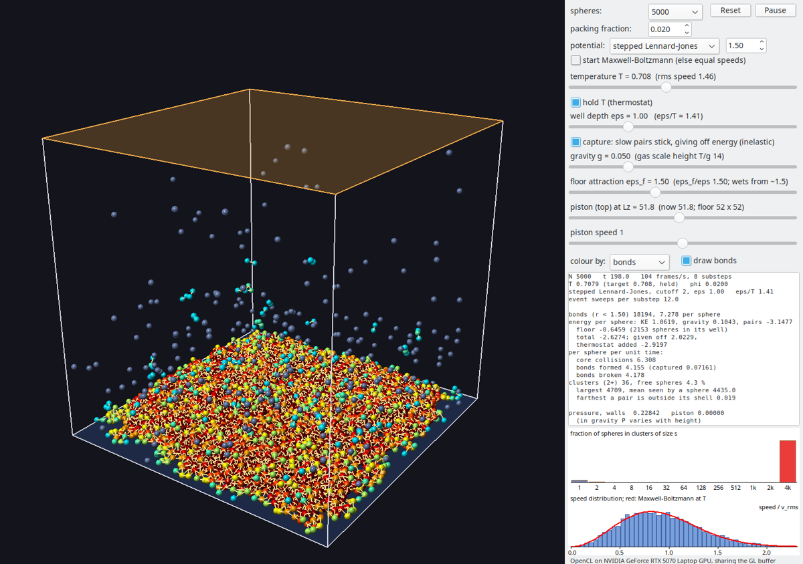
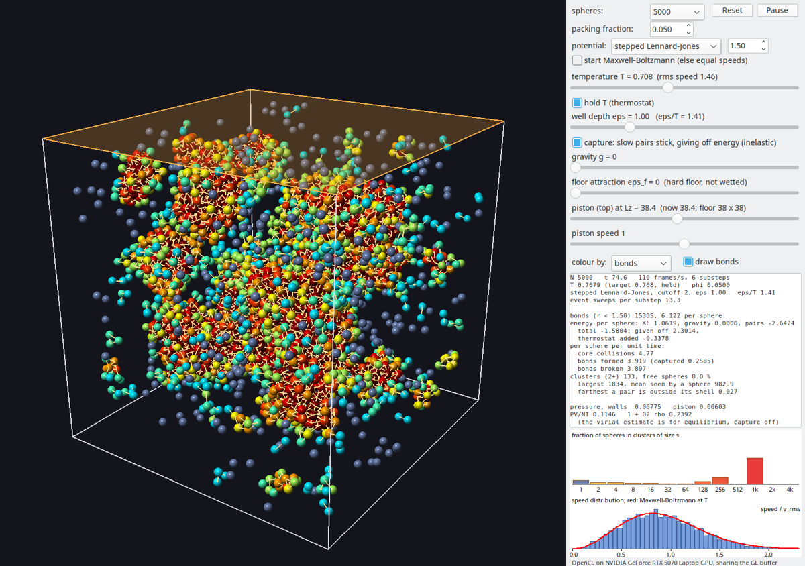

# StickySpheres

Hard spheres that attract one another through a stepped Lennard-Jones
(or square-well) potential, so they bind into clusters and break apart
again. The simulation runs on the GPU in
OpenCL and is drawn in OpenGL from the same buffer. It is a sibling of
HardSpheres, the folder above, and shares its `clgl.pas`.


*The default settings (5,000 spheres, stepped Lennard-Jones, T = 0.71, gravity 0.05, floor attraction 1.5) after 150 time units: the liquid has wet the floor (tinted blue) and covers it, about five layers deep, under a thin vapour. Colour shows bonds per sphere (grey-blue free, green to red more bonds); bonds are drawn as lines. Speeds follow Maxwell–Boltzmann, and the clusters histogram shows one cluster holding almost every sphere.*



*The same at packing fraction 0.02: the box is larger and the film about two layers thick.*



*With no gravity and a hard floor, after 75 time units: droplets nucleate, grow and merge, with Maxwell–Boltzmann speeds.*

## Build and run

```
lazbuild --ws=gtk2 StickySpheres.lpi
./run-nvidia.sh            # GL on the NVIDIA GPU, sharing the buffer with OpenCL
./StickySpheres            # GL on the Intel GPU, positions copied each frame

fpc -O2 -Fu.. -FUlib stickycheck.lpr
./stickycheck [N [max sweeps]] # headless checks, about 2 min at N = 20000
```

As in HardSpheres, OpenCL won't run on an integrated GPU (it may be driving the display, and a hang there can lock up the desktop). Pass `--allow-igpu` to `StickySpheres` or `stickycheck` to run on it anyway.

GUI options:

- **Setup:** `--n`, `--phi`, `--lambda=<w>` (square well of width w, else stepped LJ), `--eps`, `--g`, `--floor=<eps_f>` (the floor's attraction, default 1.5; 0 for a hard floor), `--temp`, `--maxwell`.
- **Behaviour:** `--nohold`.
- **Snapshot:** `--snapshot=<file.png>` with `--frames=<n>` saves the view and the window, prints the readouts and exits.

## The model

The interaction is a **stepped potential**: a hard core at r = 1, then K
flat shells. Shell s spans R_s ≤ r < R_s+1 at energy ε·U_s, and the
energy is zero beyond the cutoff R_K. Within a shell spheres move freely,
and every force is an impulse at a step. Two choices are offered:

- **Stepped Lennard-Jones (default):** nine shells out to 2σ. Each shell
  sits at the volume average of 4(r⁻¹² − r⁻⁶) across it:

  | shell | 1–1.06 | 1.06–1.12 | 1.12–1.2 | 1.2–1.3 | 1.3–1.4 | 1.4–1.5 | 1.5–1.65 | 1.65–1.8 | 1.8–2 |
  |---|---|---|---|---|---|---|---|---|---|
  | U | −0.51 | −0.95 | −0.96 | −0.77 | −0.55 | −0.39 | −0.25 | −0.15 | −0.08 |

  The shells are finest round the minimum at 1.12. The hard core stands in
  for LJ's repulsion below σ, where LJ crosses zero, so the first step
  inward (from −0.95 to −0.51) is uphill and a slow pair bounces off it.
- **Square well** of width λ (one shell, U = −1): the earlier model.

Each sphere lists every neighbour within the cutoff, with its shell; the
two lists of a pair always agree. A **bond** is a pair closer than 1.5σ,
the Stillinger criterion (the whole well for the square well). Bonds are
what is counted, coloured, drawn and joined into clusters.

Each event acts along the line of centres. u_n²/4 is the pair's relative
kinetic energy along that line, and ΔU is what the step would add to the
potential energy.

| event | what happens |
|---|---|
| core (r = 1) | elastic bounce |
| a step inward (including reaching the cutoff) | if u_n²/4 > ΔU, it steps in and u_n²/4 changes by −ΔU; if not, it bounces back |
| a step outward | if u_n²/4 > ΔU it steps out (beyond the cutoff, the pair leaves the lists); otherwise it bounces back |

Every collision conserves energy: KE + PE_gravity + PE_pairs is constant.
A pair that falls into the well speeds up and leaves again, unless a third
sphere carries the energy away. Below the critical temperature the gas
condenses into liquid in equilibrium with its vapour, and the speeds stay
Maxwell–Boltzmann.

**Capture (removed).** An earlier version had an
inelastic "slow pairs stick" option, on by default: on a downhill step
inward, a pair with less than ε of relative energy along its line of
centres gave the step's energy off instead of speeding up, and ended up
deep in the well. The thermostat put the energy back. It was taken out
because it breaks detailed balance: it bound far more vapour pairs than
equilibrium does (38 % of the spheres against about 16 % in N2OPhase) and
pulled the vapour's PV/NT down to 0.62 against about 0.95. Without it the
default settings still condense into the same wetting film within 150 time
units. It has been removed from the engine and kernel too. What was
learned along the way:

Capture stood in for the third body that would carry a gas pair's
energy away, so it applied only when one of the pair was free (had no
bonds): condensation from the gas. Inside a cluster the neighbours carry
energy away by ordinary collisions. At first capture applied everywhere,
and the liquid, its bound pairs rattling across the narrow shells,
captured about 8 times per sphere per unit time. The thermostat rescales
every velocity alike, so it put that energy back mostly into the few
vapour spheres. At T = 0.8 the liquid sat at T = 0.05 and the vapour at
39: a frozen lump on the floor, not a liquid. With capture limited to
gas pairs the liquid stays at the set temperature, moves (its
mean-square displacement over t = 10 is 4.4, as with capture off) and
settles into a puddle. A heat bath that redraws random spheres'
velocities (Andersen) was tried as well. It warms the liquid locally but
also acts as a drag on every cluster's motion, so droplets fell at only
about g/rate and the pool barely spread; it was dropped.

**Gravity** g (slider, 0 to 0.2, default 0.05) pulls along −z, down the
screen, so a condensate settles on the floor. The move step integrates it
exactly over a substep. Gravity accelerates both spheres of a pair
equally, so their relative motion is still a straight line and the pair
events need no change. A dilute gas has a barometric profile with scale
height T/g, which the slider label shows.

**The floor's attraction** ε_f (slider, 0 to 4, default 1.5) is a
one-body square well over the floor: a sphere whose centre is within one
diameter of touching the floor (0.5 ≤ z < 1.5) has energy −ε_f. Crossing
z = 1.5 downwards it gains ε_f of kinetic energy along z; crossing
upwards it loses it, or bounces back if it hasn't enough. The move step
handles it like the walls, so it conserves energy too. On a hard floor
(ε_f = 0) the liquid doesn't wet the floor: like water on wax, it lies
as a puddle as deep as surface tension and gravity allow (about 8
diameters here) and covers half the floor. An attractive floor makes it
spread. At T 0.71 (5,000 spheres, φ 0.05, measured after t = 200):

| ε_f | floor covered | liquid depth (layers) |
|---|---|---|
| 0 | 52 % | ~9 |
| 0.5 | 72 % | ~8 |
| 1.0 | 85 % | ~7 |
| 1.5 | all | ~5 |
| 2.5 | all | ~5, more of it in the first layer |

Covered means the fraction of 2 × 2 cells of floor with a sphere in the
first layer (the measure tops out at 90 % because the last row of cells
lies against the walls). Once the floor is wetted, the film's thickness
is set by the amount of liquid: 4,700 condensed spheres make five layers
on the 38 × 38 floor, and at φ 0.02 (a 52 × 52 floor) about two.

The time stepping follows HardSpheres: earliest-event mutual matching,
with each event backed up to the moment it happened. Three things were
added:

- **Matching sweeps repeat until no event is pending.** `pairs` counts the
  spheres with an event pending, and pairs/apply sweeps repeat, up to 32
  per substep. After the first sweep, only spheres that had an event or
  were picked as a partner search again.
  - A bound pair in the stepped well rattles in shells 0.06 wide, so in a
    dense cluster almost every sphere has an event due each substep. A
    sweep resolves only about 20 % of them, because the earliest-event
    picks form chains.
  - With a fixed 4 sweeps the backlog snowballed. Listed pairs drifted up
    to 6.7 diameters outside their shells, and "bonds" passed close
    packing.
  - The pending count is read every 4 sweeps, since each read waits for
    the GPU.
- **Outward crossings come from the current line of centres when the
  history is unreliable.** A listed pair's straight-line history is bent
  by its other events. When the back-extrapolated path never crossed the
  boundary, the old geometry gave u_n = 0 and the pair drifted apart for
  ever while still listed. A crossing less than 0.05 diameter back still
  uses the exact geometry; using the current line every time lets pairs
  escape too easily.
- **The back-up time is capped at two substeps.** A nearly stationary pair
  gave an enormous back-up time, and the position correction threw
  spheres across the box.

**Speed** (RTX 5070, 10,000 spheres, condensed at T 0.71): about 62
frames/s, against about 165 for the square well. The default is 5,000 spheres.

## Checks (`stickycheck`, N = 20000, about 2¼ min)

| check | result |
|---|---|
| ε = 0, φ 0.05: PV/NT | 1.226, against Carnahan–Starling 1.227 |
| no thermostat, φ 0.05, T from 0.6 | E/N constant to 4e-6 (square well) and 2e-5 (LJ) while 17,000–20,000 bonds form |
| the same, LJ, in gravity g 0.05 | constant to 2e-4 relative, as the gas falls |
| the same with the floor's attraction 1.5 | E/N range 5e-4 against 4e-4 without |
| thermostat, φ 0.01, square well, T 2 | 0.306 neighbours per sphere against ρ Σ e^(−εU/T) (4π/3)(R_s+1³ − R_s³) = 0.313; PV/NT 0.979 against 1 + B₂ρ = 0.978 |
| the same, LJ, T 2 | within the cutoff 0.640 (0.660), within 1.5 0.256 (0.263); PV/NT 0.992 (0.990) |
| the same, LJ, T 1.2 | 0.727 (0.746), 0.323 (0.329); PV/NT 0.948 (0.947) |
| ε = 0, 2000 spheres, φ 0.002, g 0.03 / 0.1 | mean height 26.0 / 10.29, against 25.67 / 10.29 from hydrostatic equilibrium with the Carnahan–Starling pressure (ideal barometric 25.45 / 9.97) |
| thermostat, LJ, T 0.6–2 | no listed pair more than 0.043 outside its shell; at φ 0.05 and no gravity, T 2 and 1 stay a gas of small clusters, T 0.6 condenses |

The neighbour counts run 2–3 % low because spheres near the walls have
fewer neighbours. In the GUI the books balance:

KE + PE_gravity + PE_pairs = start + thermostat work

The readout shows each term, the sweeps per substep, and how far any pair
is outside its shell, flagged if events are being missed.

## What it shows

- **T about 0.6–0.85, gravity on (default 0.71):** droplets rain onto
  the floor and spread into a liquid film (on a hard floor, a puddle)
  under a thin vapour, with
  Maxwell–Boltzmann speeds. With g = 0 the droplets grow and merge into one
  drop. Heat it and the liquid evaporates.
- **T about 1:** close to the critical point of this short-ranged
  (2σ cutoff) potential: a diffuse dense layer on the floor, not a
  distinct liquid.
- **Floor attraction:** from ε_f about 1.5 the liquid wets the floor and
  spreads into a film over all of it; at 0 it lies as a puddle (see
  above).
- **Piston:** the top face of the box. Only the height changes with the
  volume; the floor and side walls stay put, so lowering the lid squeezes
  the vapour down onto the pool. Compressing drives condensation;
  expanding evaporates the liquid.

## Files

- `sticky.cl`: the kernels (move, cell list, pairs, apply, scale).
- `ustickysim.pas`: `TStickySim`, which covers set-up, the frame loop,
  measurements, clusters (union–find over the bond lists) and the longest
  bond.
- `ustickymain.pas`: the window, with controls, readouts, the
  cluster-size and speed distributions, and bond lines drawn from the
  shared position buffer through an index buffer.
- `stickycheck.lpr`: the headless checks.
